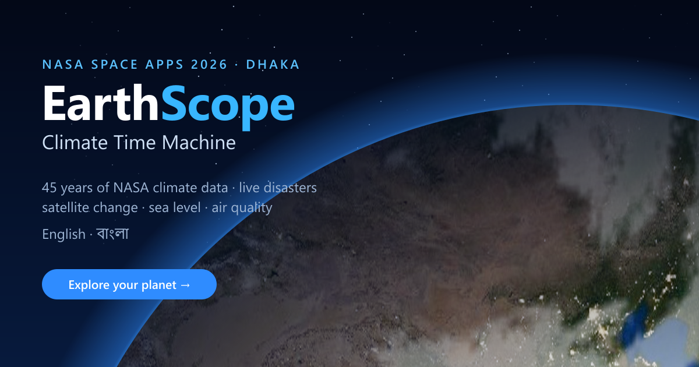

# EarthScope — Climate Time Machine

[](https://earthscope-climate.vercel.app)


**NASA Space Apps Challenge 2026 — “Be An Earth System Trend Detective!” — built with Dhaka in mind.** EarthScope turns NASA Earth observations into a climate story you can check for yourself. It covers 45 years of climate data for any place, the disasters happening on the planet right now and the safer places near you, measured land and surface-heat change from satellites, and what the IPCC says about sea level. Everything works in English and বাংলা.



## What you can do

| Page | What it does | Data |
|---|---|---|
| **Trend Lab** `/trends` | The challenge core: **what** is changing, **where**, **how much**, and **is it significant** — trend maps for 10 NASA POWER (MERRA-2) variables in 5 seasons and for MODIS day/night surface temperature and NDVI per pixel, with Mann–Kendall + trend-free pre-whitening, Sen's slope, Benjamini–Hochberg false-discovery rate and a per-cell break test (switch it off to see what a naive analysis would claim). A live case study shows **one driver, opposite trends**: irrigation cools Bangladesh's fields by day and warms them by night while Dhaka's surface heat island grows | NASA POWER, NASA MODIS (GIBS) |
| **Earth explorer** `/` | Realistic 3D globe with day/night lighting, city lights and **real cloud cover from two days ago, rebuilt every day**; climate metrics and a trend detective for any place; an independent **ERA5 cross-check** of every record | NASA POWER (MERRA-2), ECMWF ERA5, NASA GIBS VIIRS, GISTEMP |
| **Live disasters** `/disasters` | Storms, floods, earthquakes and fires happening now, cyclone forecast tracks and cones, NASA flood, fire, rain, population and **aerosol** layers. **Am I safe?** checks a location against every hazard zone and lists protective actions, the way out, and the nearest shelters and hospitals *outside* the zones. It also shows a heat outlook and **air quality** (CAMS 5-day forecast, US AQI, WHO PM2.5 guideline), *My places* alerts, and an offline safety pack | NASA EONET, GDACS, USGS, NASA GIBS, Open-Meteo, CAMS, OpenStreetMap |
| **Climate atlas** `/atlas` | World → country → state → district choropleths for 1981–2025, with play-through, climate stripes and fastest-warming rankings | NASA POWER grid, Natural Earth, geoBoundaries |
| **Satellite comparison** `/satellite` | Measured change between two years: **land cover** (MODIS MCD12Q1), **vegetation** (NDVI), **surface heat** (MODIS land-surface temperature, with hot-spot intensity and a change map relative to the area-wide shift), and like-for-like 30 m imagery (Landsat/Sentinel-2 HLS) | NASA GIBS |
| **Future scenarios** `/future` | Transparent what-if sliders to 2050, plus **IPCC AR6 sea-level projections** next to the place's ground height | IPCC AR6 WGI Table 9.9, Copernicus GLO-90 DEM |
| **Compare places** `/compare` | Two climate records side by side with honest statistics | NASA POWER |
| **Climate reports** `/reports` | An 8-page A4 assessment in English or বাংলা for citizens, students or planners, with PDF, CSV and a QR share link | All of the above |
| **Ask Earth** | A grounded AI guide (Claude, or a free open model) that answers in the interface language from EarthScope's data and live feeds, with an offline rule-based fallback | — |

Every page has its own URL, and the heavy parts (three.js, Leaflet, the report) load only when they are needed.

## Why you can trust the numbers

- **Break-tested records.** NASA POWER is a reanalysis, and reanalyses jump when the observations they assimilate change. Over Bangladesh, POWER drops by about 1 °C in 1997. EarthScope tests every series for such steps with a two-phase regression (Lund & Reeves 2002, 99% level, Monte Carlo critical values). It trends only the consistent part and says so on screen ([lib/homogeneity.ts](lib/homogeneity.ts)).
- **Independent cross-check.** Each place is compared with ECMWF ERA5, which comes from a different model and assimilation system. The comparison reports correlation, bias and trends, and runs the break test on the POWER − ERA5 difference series. That test confirms whether a step is a dataset artefact ([lib/crosscheck.ts](lib/crosscheck.ts)). For Dhaka it confirms the 1997 artefact, and ERA5 shows +0.21 °C per decade over 1981–2025.
- **Honest statistics.** Trends are least-squares slopes with 95% confidence intervals and an autocorrelation-corrected t-test (Santer et al. 2000). A change is called warming or cooling only when p < 0.05.
- **Exact satellite decoding.** NASA GIBS renders measured products with fixed colour maps. EarthScope decodes every pixel back to its land-cover class, NDVI or temperature (0.6 K steps) instead of guessing from colours.
- **Clear limits.** Hazard zones are screening estimates, not official warnings. Scenarios are labelled what-ifs, not CMIP6 output. Sea-level numbers are global means, and the app notes the delta's land subsidence.
- **Field significance.** Maps of many places use the Benjamini–Hochberg false-discovery rate (Wilks 2016), so ~5% of cells don't look “significant” by chance ([lib/trends.ts](lib/trends.ts)).
- **Tested.** 51 automated tests cover the statistics, break detection (including a regression test on the real Dhaka record), the ERA5 cross-check, colour-map decoding, Bangla dictionary parity, sea level, extremes indices and share-link safety.

## বাংলা

The whole interface, the climate report and Ask Earth's answers are available in Bangla, with Bangla digits throughout. Strings live in [lib/i18n-bn.ts](lib/i18n-bn.ts), keyed by their English source text. `npm run i18n:check` lists any untranslated string, and the test suite fails if one is missing.

## Run it

Requires Node.js 22.13 or later.

```sh
npm install
npm run dev          # http://localhost:5173
npm test             # 51 unit tests (Vitest)
npm run lint
npm run build        # Cloudflare Worker build (vinext)
npx next build       # Vercel / Node build
```

No API keys are needed. All data sources are open, and Ask Earth falls back to a free model or the offline guide. Optional settings are listed in [.env.example](.env.example):

| Variable | Purpose |
|---|---|
| `ANTHROPIC_API_KEY` | Ask Earth answers with Claude and calls EarthScope's tools itself |
| `UPSTASH_REDIS_REST_URL`, `UPSTASH_REDIS_REST_TOKEN` | Rate limits shared by all serverless instances (otherwise per instance) |
| `CRON_SECRET` | Protects the daily cloud-map warm-up cron (`vercel.json`) |
| `ASK_EARTH_RATE_LIMIT`, `ASK_EARTH_DAILY_LIMIT` | AI question limits |
| `NEXT_PUBLIC_SITE_URL` | Public URL for link previews |

Maintenance scripts (all data comes straight from the agencies):

```sh
node scripts/build-globe-textures.mts   # Blue Marble, Black Marble and the fallback cloud map
node scripts/build-global-record.mts    # GISTEMP, NSIDC sea ice, NOAA CO₂
node scripts/build-world-climate.mts    # country climate series for the atlas
node scripts/build-og-image.mjs         # link-preview image
```

## Architecture

```
app/                 Next.js app router: one page per view, API routes under app/api/*
  api/climate        NASA POWER monthly record        api/crosscheck  ECMWF ERA5 annual series
  api/disasters      EONET + GDACS + USGS feed        api/air         CAMS air quality
  api/clouds         daily cloud mask (+ /warm cron)  api/imagery     NASA GIBS snapshots
  api/ask            Ask Earth (streaming NDJSON)     api/log         client error reports
  api/trend-grid     NASA POWER monthly tiles for the Trend Lab
components/app/      shell (routing, language, state), nav, explore, views, dialogs, lazy loaders
components/          globe, disaster map, atlas, satellite comparison, report, Ask Earth
lib/                 science and data code: stats, homogeneity, crosscheck, earth-change,
                     extremes, sea-level, air-quality, clouds, hazards, i18n, report model
tests/               Vitest unit tests
```

Production safeguards include per-visitor rate limits on every costly endpoint, CDN caching that matches how often each source changes, error boundaries around each feature, and client errors reported to `/api/log`. A service worker makes the app installable and keeps the last safety check available offline.

## Project report

The complete A-to-Z report for the team and judges — what we built, how it answers the challenge, findings, methods, demo script — is in [docs/EarthScope-Project-Report.pdf](docs/EarthScope-Project-Report.pdf).

## Data sources & credits

NASA POWER · NASA GIBS (Blue Marble, Black Marble, VIIRS, MODIS land cover, NDVI, land-surface temperature and aerosol optical depth, Landsat/Sentinel-2 HLS, GPM IMERG, LANCE flood product, SEDAC population) · NASA EONET · NASA GISTEMP · NSIDC Sea Ice Index · NOAA GML CO₂ · ECMWF ERA5 and Copernicus CAMS (via Open-Meteo) · IPCC AR6 WGI · Copernicus GLO-90 DEM · GDACS (UN / European Commission JRC) · USGS Earthquake Hazards Program · OpenStreetMap contributors (ODbL) · geoBoundaries · Natural Earth · Open-Meteo geocoding and forecasts · close-zoom imagery © Esri, Maxar, Earthstar Geographics.

EarthScope is an educational tool, not an official warning service. In Bangladesh, follow the Bangladesh Meteorological Department and the Department of Disaster Management, and call **999** in an emergency.
